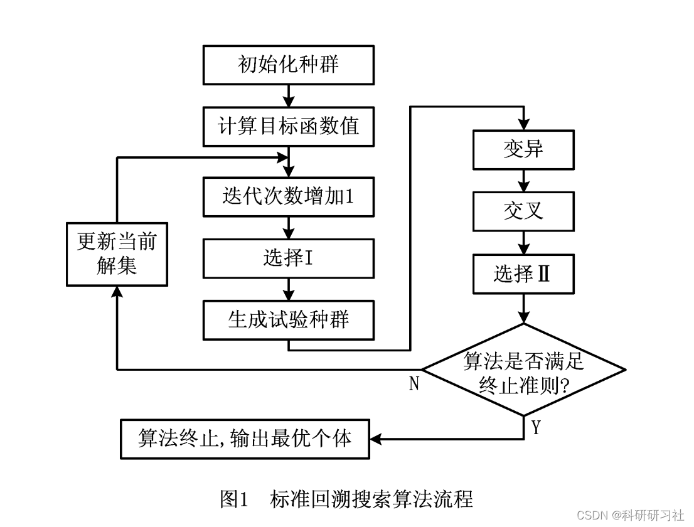
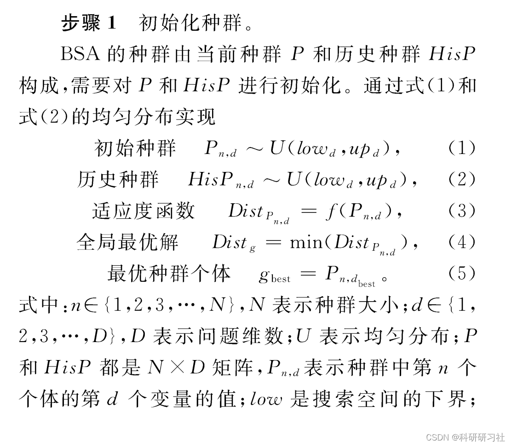
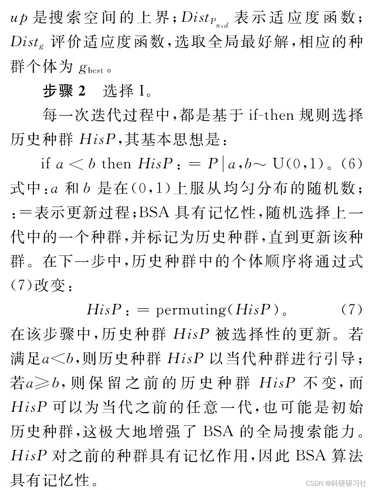
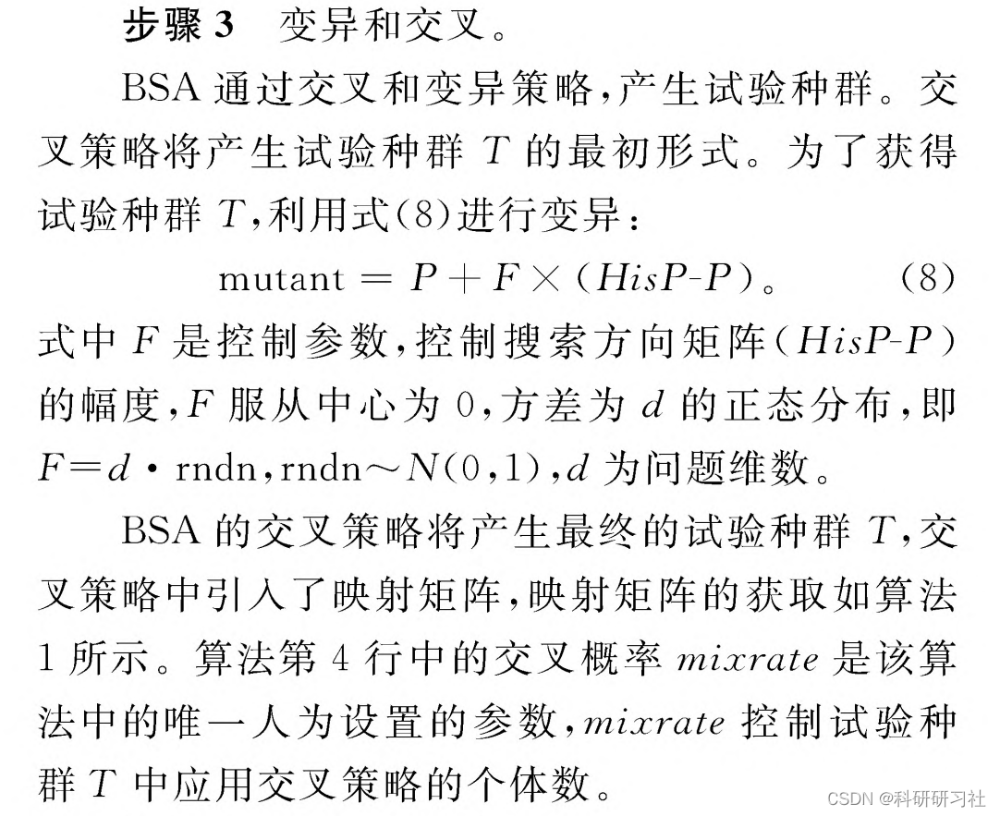
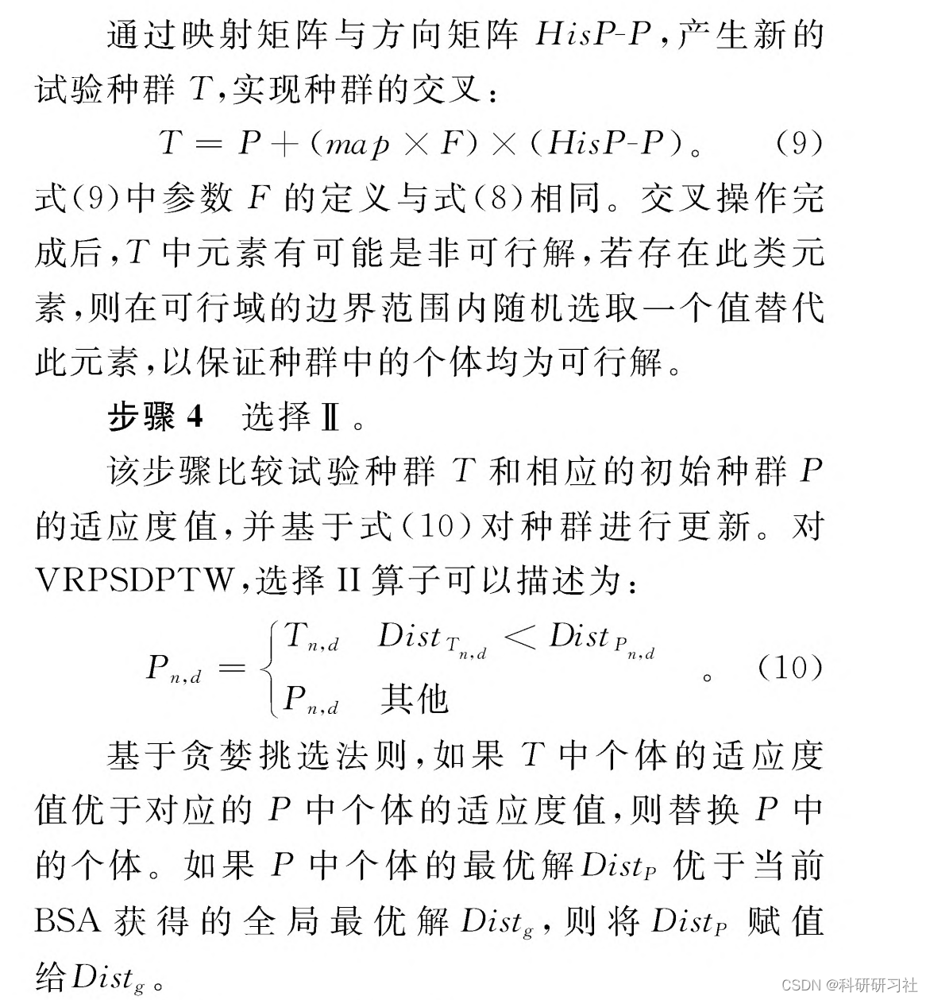
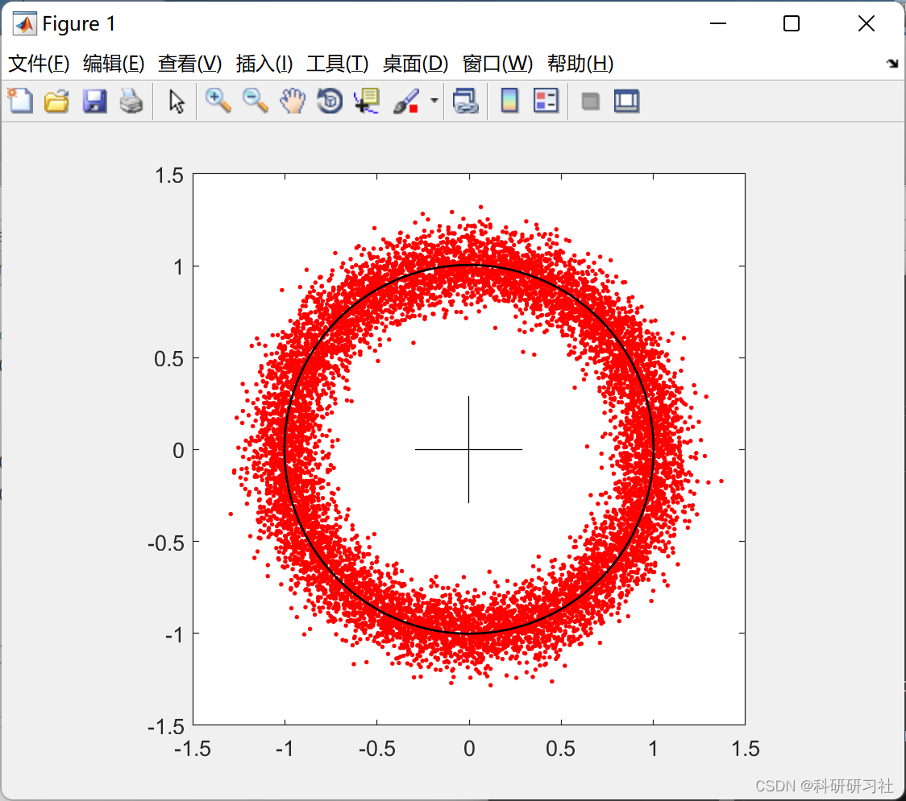

# Backtracking Search Optimization Algorithm and Its Application (BSA) (Matlab Code Implementation)

1. Overview
BSA is an optimization algorithm based on the theory of group intelligence, utilizing two unique concepts: a historical population and a mapping matrix. In each iteration, the historical population guides the optimization search, balancing both exploration (searching broadly) and exploitation (searching deeply), thereby breaking out of local optima. Regarding the depth of search, the mapping matrix further optimizes the current solution. For a more detailed introduction to the algorithm, refer to [13]. In the study of VRPSDPTW, each individual in the population represents a vehicle route plan. BSA has two selection processes, referred to as Selection I and Selection II. Selection I is used before generating a new trial population to select from the historical population. Selection II is implemented after generating a trial population to select from the better individuals. The solving process of BSA is shown in Figure 1, with the core consisting of five modules: initializing the population, Selection I, mutation, crossover, and Selection I.
Edit
This article introduces the Backtracking Search Optimization Algorithm (BSA), a novel evolutionary algorithm (EA) for solving real-valued numerical optimization problems. EA is a popular random search algorithm widely used to solve nonlinear, non-differentiable, and complex numerical optimization problems. Currently, research aims to mitigate the impact of common issues in EA, such as excessive sensitivity to control parameters, premature convergence, and slow computation. In this regard, the development of BSA is driven by efforts to develop simpler, more effective search algorithms.
Unlike many search algorithms, BSA has only one control parameter. Moreover, the problem-solving performance of BSA is not sensitive to the initial value of this parameter. BSA has a simple structure, is effective, fast, and can solve multimodal problems, making it easy to adapt to different numerical optimization problems.
The strategy for generating trial populations in BSA includes two new crossover and mutation operators. The strategy for generating trial populations and controlling the direction matrix and amplitude of the search space boundary makes BSA very powerful in exploring and developing.
Particularly, BSA possesses a memory where it stores the population from the previous generation randomly selected for generating the search direction matrix. Therefore, BSA's memory allows it to leverage experience gained from the preceding generations when preparing for experiments. This paper statistically compares the effectiveness of BSA in solving numerical optimization problems with six widely used EA algorithms (PSO, CMAES, ABC, JDE, CLPSO, and SADE) using Wilcoxon signed-rank test. 
The comparison was conducted using 75 boundary constrained benchmark problems and 3 real-world constrained benchmark problems, showing that generally, BSA can solve benchmark problems more successfully than the compared algorithms. 
2 Step Editing  
Editing  
Editing  
Editing  
3 Backtracking Search Optimization Algorithm Application 3.1 Image Processing  
Editing  
3.2 Pseudo Data Generation for Circle Fitting  
3.3 Matlab Code Implementation  
This paper only presents part of the code; for the full code, click the link:  
Backtracking Search Optimization Algorithm and Its Application (BSA) (Matlab Code Implementation)
imj=imread('testimage.tif');\n[A,B,bandnumber]=size(imj);\nimjdata=double(reshape(imj,A*B,bandnumber));\ndata.image=imj;\n\ndata.clusternumber=5; % you can change clusternumber\ndim=data.clusternumber*bandnumber;\n\n% randomly selected values for related params. of BSA\npopsize=15;\n\nbsa('imageclustering',data,popsize,dim,1,zeros(1,dim),255*ones(1,dim),1000)\nu=reshape(globalminimizer,data.clusternumber,bandnumber);\ns=dist(imjdata,u');\n[a,imb]=min(s,[],2);\nformat short g\nreport=tabulate(imb(:))\n\nimb=reshape(imb,A,B);\nassignin('base','cimj',imb);\nimshow(imj);shg\nfigure,imshow(imb,[]);colormap jet, shg\n\n\n  
4. References
[1] Wang Chao, Gao Yang, Liu Chao, Wang Minggang. Solving the vehicle routing problem with time windows and simultaneous pick-and-drop using an optimized backtracking search algorithm [J]. Computer Integrated Manufacturing Systems, 2019, 25(9): 2237-2247
[2] Wei Zhonghai, Wei Qingguo. Frequency selection for motion imagination brain-computer interface based on backtracking search optimization algorithm [J]. Science and Technology Engineering, 2015, 0(14): 70-75

## Images

<!-- PAYMENT_BLOCK -->

## Get this dataset

- Payment link (Stripe): [Buy now](https://buy.stripe.com/3cs8yP7sY87d0vu9AB)
- Payment QR code: 

<!-- /PAYMENT_BLOCK -->
